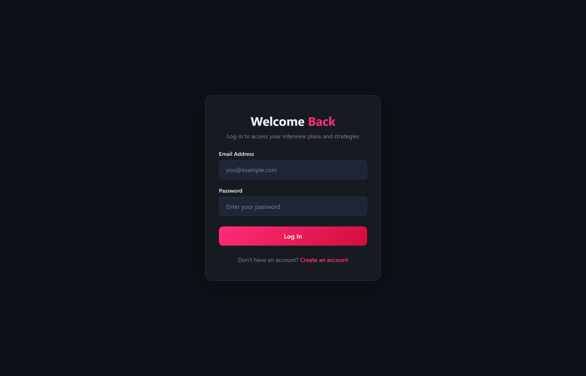
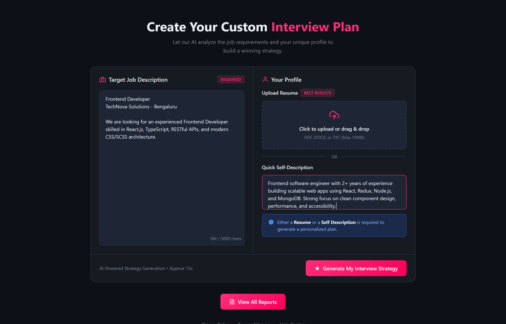
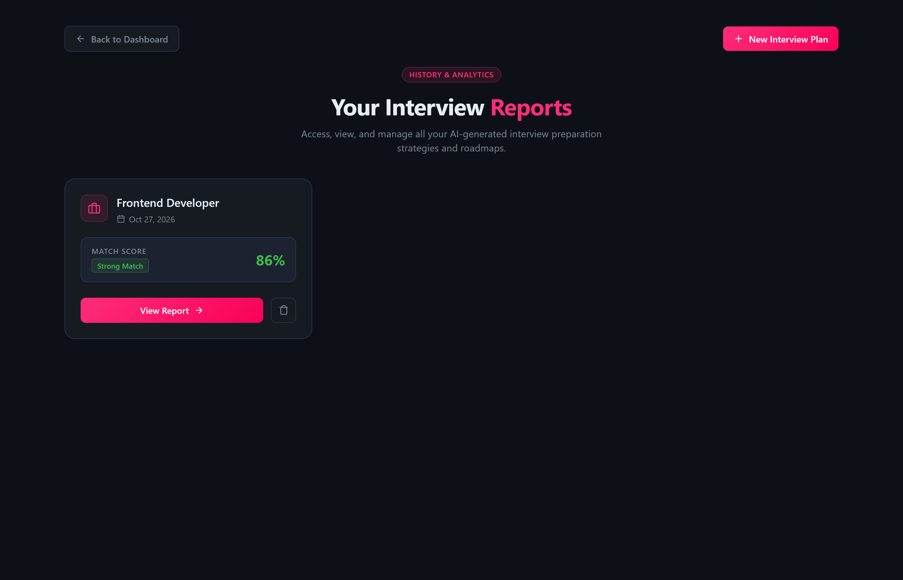
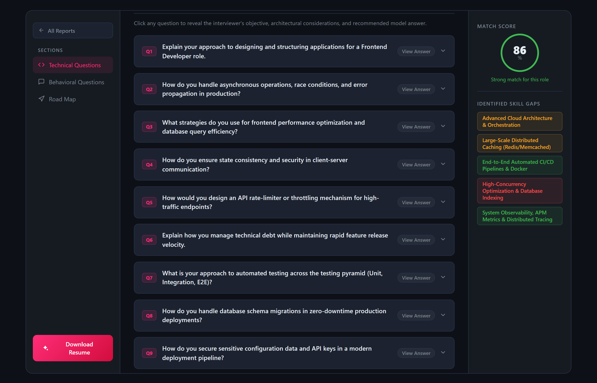

# 🚀 AI Interview Preparation Platform

An enterprise-grade, full-stack AI interview preparation and career accelerator platform built with **React.js**, **Node.js**, **Express**, **MongoDB**, **Google Gemini AI**, and **Puppeteer**.

The platform analyzes candidate resumes and target job descriptions in real time to generate deeply tailored interview strategies:
- **10 Technical Interview Questions** paired with comprehensive, multi-paragraph model answers and architecture blueprints.
- **5 Behavioral Questions** structured explicitly using the **STAR Method** (Situation, Task, Action, Result).
- **Match Score & Skill Gap Analysis** highlighting prioritized areas of improvement.
- **7-Day Targeted Preparation Roadmap** with actionable daily tasks.
- **ATS-Optimized Executive Resume PDF Generator** producing clean, professional single-page resumes formatted to pass Applicant Tracking Systems.

---

## 📸 Application Screenshots

### 1. 🔐 Authentication Page (Login)
Clean, modern dark-themed authentication with real-time validation, password encryption, and persistent JWT session cookies.



---

### 2. 🎯 Strategy Generator Dashboard (Home Page)
Interactive dual-panel dashboard allowing candidates to input target job descriptions, upload resumes via drag-and-drop, and trigger intelligent Gemini AI analysis.



---

### 3. 🗂️ Reports Dashboard (View Reports Page)
Centralized report management page showcasing all generated interview assessments with dynamic match score rings, role badges, action buttons, and deletion controls.



---

### 4. 💡 Interactive Interview Assessment & Model Answers
Comprehensive 3-column interview cockpit featuring 10 technical questions, 5 STAR behavioral questions, "Expand All Answers" toggle, copy-to-clipboard actions, 7-day study roadmap, and one-click ATS resume PDF download.



---

## 🏛️ System Architecture

```
┌────────────────────────────────────────────────────────────────────────────────────────┐
│                                 FRONTEND (React.js 19 + Vite)                          │
│                                                                                        │
│   ┌────────────────────┐   ┌───────────────────────────┐   ┌───────────────────────┐   │
│   │   Authentication   │   │  Strategy Generator Form  │   │   Reports Dashboard   │   │
│   │   Login / Register │   │   Resume / JD Drag & Drop │   │   History & Actions   │   │
│   └─────────┬──────────┘   └─────────────┬─────────────┘   └───────────┬───────────┘   │
│             │                            │                             │               │
│             ▼                            ▼                             ▼               │
│   ┌────────────────────────────────────────────────────────────────────────────────┐   │
│   │              React Context Layer (AuthContext & InterviewContext)              │   │
│   │          • Global state management, JWT cookie / Bearer token storage          │   │
│   │          • Custom Hooks: useAuth(), useInterview()                             │   │
│   └──────────────────────────────────────┬─────────────────────────────────────────┘   │
│                                          │ Axios HTTP with Credentials                 │
└──────────────────────────────────────────┼─────────────────────────────────────────────┘
                                           │
                                           ▼
┌────────────────────────────────────────────────────────────────────────────────────────┐
│                              BACKEND (Node.js & Express 5)                             │
│                                                                                        │
│   ┌──────────────────────┐  ┌───────────────────────────┐  ┌───────────────────────┐   │
│   │  Auth Middleware     │  │     File Middleware       │  │  REST Controllers     │   │
│   │  JWT Cookies/Bearer  │  │  Multer (PDF/Text, 10MB)  │  │  Auth & Interview     │   │
│   └──────────┬───────────┘  └─────────────┬─────────────┘  └───────────┬───────────┘   │
│              │                            │                            │               │
│              ▼                            ▼                            ▼               │
│   ┌────────────────────────────────────────────────────────────────────────────────┐   │
│   │                        Core Business & AI Services                             │   │
│   │                                                                                │   │
│   │   ┌─────────────────────────────────┐   ┌──────────────────────────────────┐   │   │
│   │   │  Google Gemini 2.5 Flash Engine │   │   Puppeteer Headless Renderer    │   │   │
│   │   │  • Structured Zod Schema Output │   │   • ATS-Compliant PDF Generator  │   │   │
│   │   │  • Technical & STAR Answers     │   │   • Print-Ready A4 CSS Styling   │   │   │
│   │   │  • Zero-Downtime Safe Fallback  │   │   • High-Resolution Typography   │   │   │
│   │   └─────────────────────────────────┘   └──────────────────────────────────┘   │   │
│   └──────────────────────────────────────┬─────────────────────────────────────────┘   │
│                                          │                                             │
│                                          ▼                                             │
│   ┌────────────────────────────────────────────────────────────────────────────────┐   │
│   │                     Dual-Mode MongoDB Persistence Layer                        │   │
│   │                                                                                │   │
│   │   [Primary: Cloud MongoDB Atlas] ──(Auto-Fallback if DNS/Offline)──►           │   │
│   │                                       [In-Memory MongoDB Server]               │   │
│   └────────────────────────────────────────────────────────────────────────────────┘   │
└────────────────────────────────────────────────────────────────────────────────────────┘
```

---

## 🎨 Design System & Theming

The user interface follows a modern, unified dark theme built with SCSS design tokens:

| Element | Color Code | Semantic Purpose |
| :--- | :--- | :--- |
| **Page Canvas** | `#0d1117` | Deep dark obsidian backdrop for high visual comfort |
| **Card / Container** | `#161b22` | Elevated surface for primary layout sections |
| **Panel / Inputs** | `#1c2230` / `#1e2535` | Interactive form elements and nested cards |
| **Border Delimiter** | `#2a3348` | Subtle boundaries maintaining visual hierarchy |
| **Primary Accent** | `#ff2d78` | Radiant magenta-pink for primary CTAs and active states |
| **Intention / Objectives**| `#a78bfa` | Soft violet for interviewer evaluation criteria |
| **Model Answers** | `#3fb950` | Vibrant emerald green for recommended answers & high match |
| **Skill Gap Alerts** | `#ff4d4d` | Crimson red indicating critical missing competencies |

---

## ✨ Core Features

### 1. ⚛️ Modern React.js Frontend
- **React 19 & Vite**: Ultra-fast hot module replacement (HMR), tree-shaking, and lightweight bundles.
- **Declarative Client Routing**: Powered by `react-router-dom` (v7) with protected route guards.
- **Context API Architecture**: Centralized `AuthContext` and `InterviewContext` eliminating prop-drilling.
- **Interactive Q&A Experience**:
  - Global **"Expand All Answers"** / **"Collapse All"** toggle.
  - Per-card interactive answer reveal buttons (`View Answer` / `Hide Answer`).
  - One-click **"Copy Answer"** button with dynamic copied feedback.
  - Formatted bullet points and STAR method tags for clear reading.
- **Drag-and-Drop Resume Upload**: Native HTML5 file dropzone supporting `.pdf`, `.docx`, and `.txt` up to 10MB, with immediate attachment badges and remove options.

### 2. 💡 Technical & Behavioral Questions with In-Depth Answers
- **10 Technical Questions**:
  - **Interviewer's Objective**: Identifies the exact architectural principle, performance concept, or data structure being evaluated.
  - **Comprehensive Model Answer**: Multi-point answers covering conceptual foundations, clean implementation patterns, production edge cases, and engineering trade-offs.
- **5 Behavioral Questions with STAR Method**:
  - Answers broken down into distinct stages:
    - 🔵 **Situation**: Technical context and obstacle faced.
    - 🟡 **Task**: The candidate's responsibility and target objective.
    - 🟣 **Action**: Concrete engineering or collaborative actions taken.
    - 🟢 **Result**: Quantifiable outcomes (e.g. latency reductions, MTTR drops, delivery speed).

### 3. 📄 ATS-Optimized Professional Resume PDF Generator
- Directly modeled on executive technical resumes (as demonstrated in `temp.js`).
- Generates an executive, single-page A4 PDF rendered via headless Puppeteer with:
  - **Executive Header**: Candidate Name, Target Role, Contact Row (Email, Phone, Location, Portfolio links).
  - **Professional Summary**: Role-aligned elevator pitch emphasizing value and engineering achievements.
  - **Education Matrix**: Degree, Institution, Graduation Dates, and Academic Standing (GPA/CGPA).
  - **Categorized Technical Skills**: Clean matrix for Languages, Frontend, Backend & APIs, Databases, and Developer Tools.
  - **Key Engineering Projects**: Multi-bullet achievement entries detailing architecture, technologies, and business impact.
  - **Achievements & Soft Skills**: Competitive programming milestones, hackathons, open-source work, and leadership traits.
  - **Print CSS Setup**: `@page { size: A4; margin: 10mm 14mm; }` with `-webkit-print-color-adjust: exact` and `page-break-inside: avoid`.

### 4. 📅 7-Day Targeted Preparation Roadmap
- Tailored day-by-day study roadmap addressing identified skill gaps:
  - **Day 1**: Core Language Fundamentals & Modern Architectural Patterns
  - **Day 2**: State Management, REST/GraphQL APIs & Network Resilience
  - **Day 3**: High-Frequency Technical Coding & Algorithm Optimization
  - **Day 4**: System Design, Scalability & Database Performance
  - **Day 5**: Web Security, Automated Testing & Zero-Downtime Deployments
  - **Day 6**: STAR Method Behavioral Scenarios & Technical Trade-offs
  - **Day 7**: Comprehensive Mock Interview & Final Confidence Polish

### 5. 🗂️ Reports Dashboard (View Reports)
- Unified interface displaying all previously generated interview plans.
- Dynamic match score rings (Green ≥80%, Orange ≥60%, Red <60%).
- One-click navigation to review reports, export resume PDFs, or delete outdated records.

### 6. 🛡️ Dual-Mode MongoDB Persistence (Zero-Downtime Resilience)
- Automatically tests connection to the configured `MONGO_URI`.
- If DNS resolution fails (e.g. `querySrv ENOTFOUND`) or the cloud database is offline, the backend seamlessly launches an embedded **In-Memory MongoDB Server** (`mongodb-memory-server`) so local development and testing never stall.

---

## 📂 Project Directory Layout

```
ai-interview-preparation-platform/
├── README.md                                  # Master project documentation
│
├── Backend/                                   # Node.js / Express Backend
│   ├── server.js                              # Application entry point (port 3000)
│   ├── .env                                   # Server environment variables
│   ├── package.json                           # Backend dependencies & scripts
│   └── src/
│       ├── app.js                             # Express app setup, CORS & JSON parsers
│       ├── config/
│       │   └── database.js                    # MongoDB dual-mode connection engine
│       ├── controllers/
│       │   ├── auth.controller.js             # User auth (register, login, logout, profile)
│       │   └── interview.controller.js        # Interview report generation, PDF export, delete
│       ├── middlewares/
│       │   ├── auth.middleware.js             # Dual-mode auth check (Cookie & Bearer token)
│       │   └── file.middleware.js             # Multer upload handler (10MB limit)
│       ├── models/
│       │   ├── user.model.js                  # User schema with bcrypt password hashing
│       │   ├── blacklist.model.js             # Token blacklist for instant logout invalidation
│       │   └── interviewReport.model.js       # Complete interview plan & report schema
│       ├── routes/
│       │   ├── auth.routes.js                 # Authentication REST routes
│       │   └── interview.routes.js            # Interview assessment and PDF routes
│       └── services/
│           ├── ai.service.js                  # Google Gemini API & Puppeteer PDF generation
│           └── temp.js                        # Reference candidate resume & job description data
│
└── Frontend/                                  # React.js 19 + Vite Frontend
    ├── index.html                             # Single page HTML entry
    ├── vite.config.js                         # Vite dev & build configuration
    ├── package.json                           # Frontend dependencies (React 19, Axios, SCSS)
    └── src/
        ├── App.jsx                            # Root application component
        ├── app.routes.jsx                     # Route configuration (react-router-dom v7)
        ├── main.jsx                           # React DOM mount point
        ├── style.scss                         # Global resets, dark theme variables & spinner
        ├── style/
        │   └── button.scss                    # Universal button styling & animations
        └── features/
            ├── auth/
            │   ├── auth.context.jsx           # Global user authentication provider
            │   ├── auth.form.scss             # Form inputs, cards & submit buttons
            │   ├── components/
            │   │   └── Protected.jsx          # Route guard redirecting unauthenticated users
            │   ├── hooks/
            │   │   └── useAuth.js             # useAuth custom hook
            │   ├── pages/
            │   │   ├── Login.jsx              # User login page with error alerts
            │   │   └── Register.jsx           # User registration page
            │   └── services/
            │       ├── auth.api.js            # Axios client for auth API endpoints
            │       └── interview.api.js       # Axios client for interview & PDF endpoints
            └── interview/
                ├── interview.context.jsx      # Interview state management provider
                ├── hooks/
                │   └── useInterview.js        # Custom hook for report fetching & PDF download
                ├── pages/
                │   ├── Home.jsx               # Strategy creation form with file drag-and-drop
                │   ├── Interview.jsx          # Interactive 3-column Q&A and Roadmap view
                │   └── Reports.jsx            # Reports dashboard listing candidate assessments
                └── style/
                    ├── home.scss              # Home generation page styles
                    ├── interview.scss         # Q&A cards, STAR badges & roadmap styling
                    └── Reports.scss           # Reports dashboard cards and grid styling
```

---

## 🛠️ Tech Stack & Dependencies

### Frontend
- **React 19**: Modern functional components, custom hooks, and state management.
- **Vite 8**: Next-generation lightning-fast build tool.
- **React Router DOM 7**: Client-side declarative routing and navigation guards.
- **Axios**: HTTP client configured for cross-origin credentials and file uploads.
- **Sass (SCSS)**: Modular stylesheets utilizing `@use "sass:color"` and custom variables.

### Backend
- **Node.js 22 & Express 5**: Modern server runtime and REST API framework.
- **MongoDB & Mongoose 9**: Document database and object data modeling.
- **mongodb-memory-server 11**: Automated zero-config in-memory database fallback.
- **Google Gen AI SDK (`@google/genai`)**: Integration with Gemini 2.5 Flash and Gemini 3 Flash.
- **Zod & zod-to-json-schema**: Strict type safety and structured LLM JSON output validation.
- **Puppeteer 25**: Headless Chrome rendering engine for print-quality PDF generation.
- **pdf-parse 2**: Server-side binary PDF text extraction for uploaded resumes.
- **Multer 2**: Robust multipart form-data parser supporting 10MB file payloads.
- **jsonwebtoken & bcryptjs**: Cryptographic user password hashing and JWT issuance.

---

## ⚡ Quick Start & Setup Guide

### Prerequisites
1. **Node.js** (v18.x or v20.x or v22.x)
2. **npm** (v9.x or v10.x)
3. **MongoDB** (Cloud MongoDB Atlas URI or local MongoDB, or rely on auto in-memory fallback)
4. **Google Gemini API Key** (Get free key from [Google AI Studio](https://aistudio.google.com/))

---

### Step 1: Backend Installation & Setup

1. Open your terminal and navigate to the `Backend` directory:
   ```bash
   cd Backend
   ```

2. Install dependencies:
   ```bash
   npm install
   ```

3. Configure environment variables in `Backend/.env`:
   ```env
   PORT=3000
   JWT_SECRET=your_super_secret_jwt_key_here
   MONGO_URI=mongodb+srv://<username>:<password>@cluster0.example.mongodb.net/interview-ai
   GOOGLE_GENAI_API_KEY=your_gemini_api_key_here
   ```
   > 💡 **Tip**: If `MONGO_URI` is left blank or points to an unreachable host, the backend will automatically spin up an In-Memory MongoDB instance so you can start developing immediately!

4. Start the backend server:
   ```bash
   node server.js
   # or with live reloading:
   npm run dev
   ```
   The backend server will run on **http://localhost:3000**.

---

### Step 2: Frontend Installation & Setup

1. Open a new terminal tab and navigate to the `Frontend` directory:
   ```bash
   cd Frontend
   ```

2. Install dependencies:
   ```bash
   npm install
   ```

3. Launch the Vite development server:
   ```bash
   npm run dev
   ```
   The application will be live at **http://localhost:5173**.

---

## 📡 REST API Reference

### 🔐 Authentication (`/api/auth`)

#### 1. Register User
- **Method**: `POST`
- **Endpoint**: `/api/auth/register`
- **Payload**:
  ```json
  {
    "username": "johndoe",
    "email": "john.doe@gmail.com",
    "password": "Password123!"
  }
  ```
- **Response** (`201 Created`):
  ```json
  {
    "message": "User registered successfully",
    "user": {
      "id": "6adf968dbc9ff569935424be",
      "username": "johndoe",
      "email": "john.doe@gmail.com"
    },
    "token": "eyJhbGciOiJIUzI1NiIsInR5cCI6Ik..."
  }
  ```

#### 2. User Login
- **Method**: `POST`
- **Endpoint**: `/api/auth/login`
- **Payload**:
  ```json
  {
    "email": "john.doe@gmail.com",
    "password": "Password123!"
  }
  ```
- **Response** (`200 OK`): Sets `token` in `HttpOnly` cookie and returns user profile + token JSON.

#### 3. User Logout
- **Method**: `POST`
- **Endpoint**: `/api/auth/logout`
- **Headers**: `Authorization: Bearer <token>` or Cookie
- **Response** (`200 OK`): Blacklists token and clears auth cookie.

---

### 💼 Interview Assessment & PDF (`/api/interview`)

#### 1. Generate Interview Strategy
- **Method**: `POST`
- **Endpoint**: `/api/interview/`
- **Content-Type**: `multipart/form-data` or `application/json`
- **Headers**: `Authorization: Bearer <token>`
- **Body Fields**:
  - `resume`: Binary file attachment (`.pdf`, `.docx`) or plain text string
  - `jobDescription`: String (Target role requirements)
  - `selfDescription`: String (Optional candidate summary)
- **Response** (`201 Created`):
  ```json
  {
    "message": "Interview report generated successfully.",
    "interviewReport": {
      "_id": "6adf968dbc9ff569935424be",
      "title": "Frontend Developer",
      "matchScore": 86,
      "technicalQuestions": [
        {
          "question": "Explain your approach to designing and structuring applications for a Frontend Developer role.",
          "intention": "Assess architectural knowledge, modular code organization, and scalability considerations.",
          "answer": "• Architectural Separation: Structure the application into clean, decoupled layers..."
        }
      ],
      "behavioralQuestions": [
        {
          "question": "Describe a complex technical challenge you faced and how you overcame it.",
          "intention": "Evaluate problem-solving methodology, persistence, and technical depth.",
          "answer": "• Situation: During peak traffic on an e-commerce platform...\n• Task: ...\n• Action: ...\n• Result: ..."
        }
      ],
      "skillGaps": [
        { "skill": "Large-Scale Distributed Caching", "severity": "medium" }
      ],
      "preparationPlan": [
        {
          "day": 1,
          "focus": "Core Language Fundamentals & Modern Architectural Patterns",
          "tasks": ["Review execution lifecycles, event loop mechanics...", "..."]
        }
      ]
    }
  }
  ```

#### 2. Get All User Reports
- **Method**: `GET`
- **Endpoint**: `/api/interview/`
- **Headers**: `Authorization: Bearer <token>`
- **Response** (`200 OK`): Returns array of summary report cards (ID, title, score, date).

#### 3. Get Report by ID
- **Method**: `GET`
- **Endpoint**: `/api/interview/report/:interviewId`
- **Response** (`200 OK`): Full interview strategy JSON.

#### 4. Download Tailored ATS Resume PDF
- **Method**: `GET` or `POST`
- **Endpoint**: `/api/interview/resume/pdf/:interviewReportId`
- **Response** (`200 OK`):
  - **Content-Type**: `application/pdf`
  - **Content-Disposition**: `attachment; filename=resume_<id>.pdf`
  - **Body**: Binary PDF buffer ready for download or browser preview.

#### 5. Delete Report
- **Method**: `DELETE`
- **Endpoint**: `/api/interview/:id`
- **Response** (`200 OK`): Deletes report and returns confirmation.

---

## 🔍 How to Use the Application

1. **Sign Up / Log In**:
   - Navigate to `/register` to create a new user profile, or log in via `/login`.
2. **Create Interview Strategy**:
   - In the target role textarea, paste any real job description (e.g. from LinkedIn or Indeed).
   - Drop your resume PDF into the upload container or enter a summary of your experience.
   - Click **"Generate My Interview Strategy"**.
3. **Review In-Depth Q&As**:
   - Switch between **Technical Questions** and **Behavioral Questions**.
   - Use **"Expand All Answers"** or click on any individual question card to inspect the interviewer's objective and model answer.
   - Click **"Copy Answer"** to copy model answers directly for note-taking.
4. **Follow 7-Day Study Roadmap**:
   - Switch to the **Road Map** tab to review your daily milestone checklist.
5. **Download Professional Resume PDF**:
   - Click **"Download Resume"** in the left navigation sidebar to receive an executive, ATS-tailored PDF resume.
6. **Manage History in Reports Dashboard**:
   - Click **"All Reports"** or navigate to `/reports` to view, revisit, or delete past generated reports.

---

## 🧪 Testing the Full End-to-End Flow

To verify backend authentication, report generation, and PDF generation from the command line:

```bash
cd Backend
node -e "
async function verify() {
  const reg = await fetch('http://127.0.0.1:3000/api/auth/register', {
    method: 'POST',
    headers: { 'Content-Type': 'application/json' },
    body: JSON.stringify({ username: 'tester', email: 'test_' + Date.now() + '@example.com', password: 'Password123!' })
  });
  const { token } = await reg.json();
  const { resume, selfDescription, jobDescription } = require('./src/services/temp.js');
  const rep = await fetch('http://127.0.0.1:3000/api/interview/', {
    method: 'POST',
    headers: { 'Content-Type': 'application/json', 'Authorization': 'Bearer ' + token },
    body: JSON.stringify({ resume, selfDescription, jobDescription })
  });
  const { interviewReport } = await rep.json();
  console.log('✓ Report Created:', interviewReport._id, 'Match:', interviewReport.matchScore + '%');
  const pdf = await fetch('http://127.0.0.1:3000/api/interview/resume/pdf/' + interviewReport._id, {
    method: 'POST',
    headers: { 'Authorization': 'Bearer ' + token }
  });
  const buf = await pdf.arrayBuffer();
  console.log('✓ Resume PDF Downloaded successfully, size:', buf.byteLength, 'bytes');
}
verify();
"
```

---

## 📄 License

This project is licensed under the **MIT License**. Feel free to use, modify, and distribute it for personal and commercial projects.
